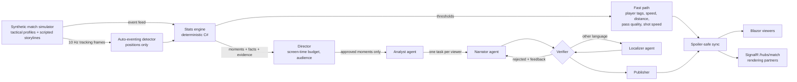

# WhyLine

> **Not just what happened. Why it mattered, and how we know.**

WhyLine is a multi-agent match-intelligence system built on **Microsoft Foundry** and **Microsoft Agent Framework**. It
turns a live stream of synthetic football events into explained, verified and personalized storytelling: every insight
says *why* a moment mattered, every number in it is traced back to the data, and each viewer gets it in their own
language, voice and stream delay, without spoilers.

---

## Contents

- [Reviewer quick start (5 minutes, no Azure needed)](#reviewer-quick-start)
- [What makes it different](#what-makes-it-different)
- [How it works](#how-it-works)
- [The agent newsroom](#the-agent-newsroom)
- [Microsoft Foundry and Agent Framework](#microsoft-foundry-and-agent-framework)
- [Evaluation results](#evaluation-results)
- [Observability](#observability)
- [Run with your own Foundry project](#run-with-your-own-foundry-project)
- [Fixtures](#fixtures)
- [API for rendering partners](#api-for-rendering-partners)
- [Hackathon requirements and judging criteria](#hackathon-requirements-and-judging-criteria)
- [Tests](#tests)
- [Deploying to Azure (optional)](#deploying-to-azure-optional)
- [Project layout and docs](#project-layout-and-docs)
- [Limitations and next steps](#limitations-and-next-steps)

---

## Reviewer quick start

Requirements: **.NET 10 SDK**. No Azure account or keys are needed: by default WhyLine runs its deterministic template
agents offline, through exactly the same newsroom, Verifier and UI as the Foundry agents.

```bash
git clone https://github.com/adnansaleem1/whyLine.git
cd whyLine
dotnet build WhyLine.slnx
dotnet test tests/WhyLine.Tests
dotnet run --project src/WhyLine.Web
```

In Visual Studio or Rider, open `WhyLine.slnx` and pick a launch profile: **WhyLine (Template agents)** (offline),
**WhyLine (Foundry agents)** or **WhyLine (Foundry agents, Entra ID)**.

Open **http://localhost:5080**. The match kicks off automatically at 15× speed. Then try:

1. **Pick a fixture** from the list in the header, for example *Ironvale Rovers v Saltmere Athletic*. Five scripted
   matches are included (see [Fixtures](#fixtures)).
2. **Compare the two viewers.** Viewer A is an English tactical analyst watching live. Viewer B is a casual fan of the
   away side watching in **Urdu, 30 seconds behind live**: their cards arrive in Urdu, right-to-left, and are held until
   their own stream reaches the moment ("insights held" counter), so nothing is spoiled.
3. **Click any sentence** in an insight card: the evidence behind it (the events that prove it) is drawn on the pitch.
   That is the *why line*.
4. **Press "Catch me up"** on a viewer: a recap of everything *that viewer has seen so far*, never beyond it.
5. **Change a viewer**: mode (Analyst, Casual, Player Focus, Audio Description), language (English, Urdu, Spanish,
   Arabic), favourite club, focus player, stream delay. New settings apply from the next moment.
6. **Watch the Agent newsroom panel** (bottom right): Director decisions, Analyst briefs, drafts, Verifier approvals and
   rejections, fallbacks and publish times, live.
7. **Speak insights** reads cards aloud with **Azure AI Speech** neural voices (for example `ur-PK-AsadNeural` for
   Urdu), the basis of the Audio Description persona. With no key configured (as in this quick start), the browser's voices are used.

8. **Demo: jump to…** (top right) skips to just before any goal, big chance or tactical switch, or to full time, and
   plays on at 4× so the Foundry agents keep up. The skipped stretch is still analysed (stats, momentum, recaps).

Useful endpoints while it runs: `GET /api/agents` (every agent's role, contract and system message),
`GET /api/traces`, `GET /api/match/moments`, `GET /api/autoeventing`.

To see the real model path, follow [Run with your own Foundry project](#run-with-your-own-foundry-project).

---

## What makes it different

Most match AI shows *what* happened (a stat, a highlight). WhyLine is built around three ideas:

| Idea | What it means in the product |
|---|---|
| **Explained momentum** | The momentum chart is annotated with *why* it swung (a high press, a tactical switch, a spell of control), from computed facts such as pressures per minute and high regains. |
| **Clickable provenance** | Every published sentence is a citation linked to the events that prove it, and every number in it has passed a deterministic Verifier. Clicking a sentence draws the evidence on the pitch. |
| **Spoiler-safe sync** | Each insight carries the match-clock time it belongs to. Every viewer receives it only when *their* stream reaches that moment, whatever their delay. Catch-me-up never reveals what a viewer hasn't seen. |

Plus: four personas (including **Audio Description** for blind and low-vision fans, which says where on the pitch the
action is before what happened), four languages with local commentary styles and right-to-left rendering, Azure AI Speech
neural voices in every language (a calmer, slower voice for Audio Description), half-time and
full-time recaps, and a REST/SignalR feed so a broadcaster's graphics system can render the same cues.

---

## How it works



- **Two speeds.** Player tags, speed and distance badges, pass-quality and shot-speed cards come straight from code in
  milliseconds. Explanations, narratives and recaps come from the agent path in a few seconds (median about 9 s from
  the Director's decision to a published card with Foundry models), about as long as a human analyst takes.
- **Agents only write words.** The stats engine computes every number as a `Fact`, and each `Moment` carries the event
  ids that prove it. Models never compute statistics.
- **Verify, then publish.** The Verifier extracts every number (including Urdu and Arabic digits) and every player name
  from a draft and rejects anything that is not traceable to a fact; it also rejects Urdu or Arabic written in Latin
  script. A rejected draft goes back to its author with the reason; after two retries the deterministic template voice
  is used. Nothing unverified is ever published.
- **Synthetic data, real signals.** A seeded simulator plays a full 90 minutes with tactical profiles (possession, high
  press, low block, counter) and scripted storylines, producing an event feed and 10 Hz tracking. An auto-eventing
  detector rebuilds passes and ball speed from positions alone and is scored against the feed (over 80% recall and
  precision, under 1 km/h speed error).

---

## The agent newsroom

| Agent | Kind | Model tier | Responsibility |
|---|---|---|---|
| **Director** | Deterministic | – | Producer. Runs first: importance and per-viewer relevance, screen-time budget, staleness, de-duplication. Rejected moments never cost a model call. |
| **Analyst** | Foundry model | Reasoning (`gpt-5.5`) | Explains why the moment matters (cause, context, what to watch next) from the moment's facts. Runs once per moment; every narrator reuses it. |
| **Narrator** | Foundry model | Fast (`gpt-5.4-mini`) | Turns the brief into on-screen copy for one viewer persona (Analyst, Casual, Player Focus, Audio Description). |
| **Localizer** | Foundry model | Fast | Rewrites a verified English card in Urdu, Spanish or Arabic, in a local commentary style, in the language's own script. |
| **Verifier** | Deterministic | – | Approves, sends back with feedback, or falls back. Separation of duties: the agents that write never approve their own work. |
| **Recap** | Foundry model | Reasoning | Half-time, full-time and catch-me-up summaries from the verified moment log, in match order. |

Each agent's role, responsibilities, audience, boundaries, input and output contract, data access, "when unsure"
behaviour, failure behaviour and system message are defined once in `AgentCatalog`. They follow Microsoft's
system-message guidance (role and task, audience and tone, scope, output format, when unsure, grounding, safety
including a prompt-injection rule, examples) and the Cloud Adoption Framework's multi-agent guidance (why a separate
agent, least privilege, explicit contracts, workflows over manual chaining). Generated reference:
[docs/agents.md](docs/agents.md), also served at `GET /api/agents`.

The newsroom runs as a **Microsoft Agent Framework workflow graph** (`NewsroomWorkflow`): one executor per agent, typed
messages between them, conditional edges for Verifier retries, localisation and fallback, and fan-out to one Narrator
task per viewer. See [docs/newsroom-workflow.md](docs/newsroom-workflow.md). Offline builds run the same steps
(`NewsroomSteps`) with an in-process runner, so the tests cover the same logic.

**Resilience.** A model call that fails, times out or returns invalid JSON falls back to the template agent for that
step and is marked in the newsroom panel. Up to four moments are processed concurrently so a slow call never holds up
the next moment.

---

## Microsoft Foundry and Agent Framework

| What | How WhyLine uses it |
|---|---|
| Foundry model deployments | Two tiers: `gpt-5.5` for the Analyst and Recap, `gpt-5.4-mini` for the Narrator and Localizer. Reasoning effort is configurable per tier (default Low, which keeps the Analyst at about 2.5 s). |
| `Microsoft.Agents.AI.Foundry` | Agents created from the catalog with `AIProjectClient.AsAIAgent(...)` (Microsoft Entra ID), or from the resource's OpenAI v1 endpoint with an API key. |
| `Microsoft.Agents.AI.Workflows` | The newsroom graph: executors, typed edges, conditional routing, workflow output events. |
| Agent Framework OpenTelemetry | `UseOpenTelemetry` on every agent and `WithOpenTelemetry` on the workflow: GenAI-convention spans (model, tokens, prompts) inside WhyLine's own per-moment trace, exported to Application Insights and Foundry Tracing. |
| `Microsoft.Extensions.AI.Evaluation` | The evaluation harness: Groundedness, Relevance, Coherence and Fluency evaluators judged by the Foundry deployment, Foundry's content-safety evaluation service (`--safety`) and a custom fact-trace evaluator. |
| Azure AI Speech | Neural text-to-speech through the Foundry resource (a multi-service Azure AI resource, so the same key works): a commentary voice and an Audio Description voice per language, SSML with per-voice speaking rate, audio streamed to the browser. Region detected automatically. |
| Azure Developer CLI templates | Bicep for Container Apps with a managed identity that signs in to the Foundry project, and an Application Insights connection on the project (optional, see below). |

---

## Evaluation results

The evaluation ([how to run it](#run-with-your-own-foundry-project)) plays all five fixtures, runs the key moments (every goal, the most important other moments and full
time) through the **Foundry** newsroom for three viewers (English analyst, English casual fan, Urdu casual fan), and
scores every published card. Latest full run: **60 cards**, agents `gpt-5.5` / `gpt-5.4-mini`, judge `gpt-5.5`.

| Metric | Score | What it checks |
|---|---|---|
| Fact trace | **100% pass** | Every number and player name traces to a computed fact (WhyLine's Verifier, re-run independently) |
| Groundedness | **4.57 / 5** | Claims are supported by the stats engine's facts only, not by the Analyst's prose |
| Relevance | **4.27 / 5** | Answers "what happened and why it matters" for that viewer |
| Coherence | **4.25 / 5** | Logical and in match order |
| Fluency | **3.92 / 5** | Natural language, including Urdu |
| First-draft acceptance | 100% | Cards approved by the Verifier without a rewrite |

**The evaluation changed the product.** It found two real problems, both fixed and re-measured:

1. *Casual cards said what happened but not why it mattered* (relevance 3.0 against 5.0 for the analyst). The Casual
   persona guide now requires a sentence on what the moment changes; on the comeback fixture relevance went from 3.78
   to 4.33.
2. *Urdu sometimes came back in Roman script* (3 of 20 cards). The Localizer now writes in Urdu script and the Verifier
   rejects Latin-script Urdu: 0 of 20 in the next run, and Urdu groundedness went from 4.10 to 4.35.

What it still flags is meaning rather than numbers (for example "leads" written when the score is level), which the
Verifier does not check yet. Full write-up: [docs/observability-and-evaluation.md](docs/observability-and-evaluation.md).
Raw results: [eval/summary.md](eval/summary.md) and [eval/results.json](eval/results.json).

---

## Observability

Every moment is **one OpenTelemetry trace**: a root span for the moment, a span per agent step (Director decision,
Analyst brief, each draft, each Verifier verdict with its feedback, publish), and Agent Framework's model-call spans
inside. Metrics: moments directed, cards published, Verifier rejections, fallbacks and time-to-card.

- **Foundry → Tracing:** set `Telemetry:ApplicationInsightsConnectionString` to the Application Insights resource
  connected to your Foundry project.
- **Locally:** run the .NET Aspire dashboard
  (`docker run --rm -it -p 18888:18888 -p 4317:18889 mcr.microsoft.com/dotnet/aspire-dashboard:latest`) and set
  `Telemetry:OtlpEndpoint` to `http://localhost:4317`.

With neither set, telemetry is off. Details: [docs/observability-and-evaluation.md](docs/observability-and-evaluation.md).

---

## Run with your own Foundry project

You need a Microsoft Foundry project with two chat model deployments (for example `gpt-5.5` and `gpt-5.4-mini`). Put your
settings in `src/WhyLine.Web/appsettings.Local.json`, which is git-ignored and kept out of the container image:

```bash
cp src/WhyLine.Web/appsettings.Local.example.json src/WhyLine.Web/appsettings.Local.json
```

Fill in the project endpoint and model deployment names. For the API key (Foundry portal → your resource → Keys and
Endpoint), either fill in `ApiKey` or remove that line and sign in with Microsoft Entra ID (`az login`; needs the Azure AI
User role on the Foundry resource). .NET user secrets work too (`dotnet user-secrets set "Agents:Foundry:ApiKey" "<key>"`
in `src/WhyLine.Web`).

Then run with a Foundry launch profile:

```bash
dotnet run --project src/WhyLine.Web --launch-profile "WhyLine (Foundry agents)"
dotnet run --project src/WhyLine.Web --launch-profile "WhyLine (Foundry agents, Entra ID)"   # forces Entra ID
```

The newsroom panel header switches to **Microsoft Foundry agents · Agent Framework workflow**, and the startup log
shows the auth mode and the voice (`Speech: Azure AI Speech (<region>)`).

Run the evaluation (calls your Foundry models; a full run takes several minutes):

```bash
dotnet run --project tools/WhyLine.Evaluate                                      # all fixtures
dotnet run --project tools/WhyLine.Evaluate -- --matches comeback --moments 2    # quick: one fixture
dotnet tool restore
dotnet tool run aieval report --path eval/store --output eval/report.html        # HTML report
```

Results go to `eval/summary.md` and `eval/results.json`; add `--safety` for Foundry's content-safety evaluation.

### Voices

With **Speak insights** on, cards are read aloud with Azure AI Speech neural voices, one per language and persona (for
example `ur-PK-AsadNeural` for Urdu). WhyLine reuses the Foundry API key, since a Foundry resource is a multi-service
Azure AI resource, and detects its region; set `Speech:Region` if detection fails. Without a key, or if a call fails,
the browser's own voices are used. The label under the button shows which voice is speaking (for example
*Azure AI Speech · ur-PK-AsadNeural*). Speech works in either agent mode; it only needs a key.

| Language | Commentary voice (Analyst, Casual, Player Focus) | Audio Description voice |
|---|---|---|
| English | `en-GB-RyanNeural`, +8% | `en-GB-SoniaNeural`, −5% |
| Urdu | `ur-PK-AsadNeural`, +5% | `ur-PK-UzmaNeural`, −5% |
| Spanish | `es-MX-JorgeNeural`, +8% | `es-MX-DaliaNeural`, −5% |
| Arabic | `ar-SA-HamedNeural`, +5% | `ar-SA-ZariyahNeural`, −5% |

Audio is synthesized on the server (`SpeechService`, SSML with the card text escaped), cached per voice and text, and
streamed to the browser, so the key never reaches the page.

### Configuration reference

| Setting | Default | Meaning |
|---|---|---|
| `Agents:Mode` | `Template` | `Template` (offline, deterministic) or `Foundry` |
| `Agents:Orchestration` | `Workflow` | `Workflow` (Agent Framework graph) or `InProcess` |
| `Agents:Foundry:ProjectEndpoint` | – | Foundry project endpoint |
| `Agents:Foundry:Auth` | `Auto` | `Auto` (API key if set, otherwise Entra ID), `ApiKey` or `EntraId` |
| `Agents:Foundry:ApiKey` | – | Optional; keep it in user secrets |
| `Agents:Foundry:ReasoningModel` / `FastModel` | `gpt-5.5` / `gpt-5.4-mini` | Deployment names per tier |
| `Agents:Foundry:ReasoningEffort` / `FastReasoningEffort` | `Low` | `None`, `Low`, `Medium`, `High` or `ExtraHigh` |
| `Agents:Foundry:RecordContentInTraces` | `true` | Record prompts and completions on model-call spans |
| `Agents:MaxVerifierRetries` | `2` | Rewrites before the template fallback |
| `Agents:AgentTimeoutSeconds` | `20` | Per model call |
| `Agents:MaxConcurrentMoments` | `4` | Moments processed at once |
| `Agents:ScreenBudgetSeconds` | `40` | Minimum match seconds between two insight cards per viewer |
| `Match:Scenario` / `Seed` / `Speed` | `press-flip` / `7` / `15` | Fixture, simulator seed and replay speed |
| `Telemetry:ApplicationInsightsConnectionString` / `OtlpEndpoint` | – | Exporters (off when empty) |
| `Speech:Enabled` | `true` | Azure AI Speech neural voices (browser voices when off or unavailable) |
| `Speech:Key` | – | Speech key; empty reuses `Agents:Foundry:ApiKey` |
| `Speech:Region` | – | Speech region; empty detects it from the Foundry resource |
| `Speech:Endpoint` | – | Resource endpoint for region detection; empty derives it from the project endpoint |

---

## Fixtures

All clubs and players are fictional. Pick one in the Studio header, with `Match:Scenario`, or with
`POST /api/control {"action":"load","scenario":"comeback"}`. The teaser shown to viewers never gives away the result.

| Fixture | Story | Scripted result | Good for showing |
|---|---|---|---|
| `press-flip` Northbridge City v Harbour United | A high press after the break turns the game | 1-2 | Tactical shift, explained momentum swing |
| `comeback` Ironvale Rovers v Saltmere Athletic | 0-2 at half-time, all-out press, stoppage-time winner | 3-2 | Game-state narratives, recaps |
| `stalemate` Larkhaven FC v Eastmarsh Albion | Possession against a deep block, big chances missed | 0-0 | Control versus chaos with no goals to lean on |
| `smash-and-grab` Corvane City v Duskmoor United | Dominant hosts, one counter decides it | 0-1 | Explaining an "unfair" result with xG |
| `thriller` Halden Forge v Marrow Bay | Two pressing sides trade goals | 3-3 | The newsroom keeping up in a busy match |

---

## API for rendering partners

| Endpoint | Purpose |
|---|---|
| `GET /api/match` | Metadata, live status, snapshot, agent mode and orchestration |
| `GET /api/matches` | Fixtures that can be loaded (no results, to avoid spoilers) |
| `GET /api/match/events?since=<seconds>` | Event feed (schema: `docs/schemas/match-event.schema.json`) |
| `GET /api/match/moments` | Detected moments with facts and evidence |
| `GET /api/match/chapters` | Demo mode chapters: kick-off, each scripted goal, chance and tactical switch, full time |
| `GET /api/cues?since=<index>&profileKey=<key>` | Overlay cues (schema: `docs/schemas/overlay-cue.schema.json`) |
| `GET /api/traces` | Agent newsroom trace |
| `GET /api/agents` | Every agent's definition and system message |
| `GET /api/autoeventing` | Auto-eventing recall, precision and speed error |
| `POST /api/control` | `{ "action": "play" \| "pause" \| "restart" \| "load" \| "jump", "scenario": "comeback", "speed": 15, "seed": 7, "seconds": 3570 }` |
| `POST /api/catchmeup` | `{ "profile": {...}, "playbackSeconds": 3600 }` |
| SignalR `/hubs/match` | Server pushes `status`, `cue`, `trace`; clients call `RegisterProfile(profile)` |
| `GET /health` | Liveness |

---

## Hackathon requirements and judging criteria

| Requirement | Where |
|---|---|
| Ingest live synthetic events | `MatchSimulator`, `LiveMatch` (10 Hz tracking and an event feed) |
| Interpret into stats and patterns | `MatchAnalyzer`, `PassQuality`, control index, momentum |
| Explain why a moment matters | Explained momentum, Analyst agent, `MomentKind` detectors |
| Render alongside the match | Timed `OverlayCue`s, pitch overlays, lower thirds, SignalR hub |
| Personalize | Persona, language, favourite club, focus player and stream delay per viewer |
| Player identification, speed and distance badges | Ball-carrier name tag, `ThresholdCrossing` badges |
| Pass distance, accuracy and difficulty | `PassQuality.Difficulty`, pass-quality cards, team and player accuracy |
| Ball and shot speed | Event speeds and tracking-derived speeds |
| Auto-eventing | `TrackingEventDetector` (passes and ball speed from positions only, scored against the feed) |
| Narratives, milestones and recaps | Narrator and Recap agents, pass streaks, distance milestones |
| Explainability (control vs chaos, pressure, rhythm) | Control index, press-surge and momentum-swing facts, clickable provenance |
| Data innovation | Seeded simulator, tactical profiles, five scripted fixtures, event and cue schemas |
| Multi-language storytelling | Urdu, Spanish and Arabic; local commentary styles; right-to-left rendering; script check; Azure AI Speech neural voices per language |

| Judging criterion | Evidence |
|---|---|
| Technical implementation (Foundry) | Foundry models in two tiers through Agent Framework, a workflow graph, OpenTelemetry to Foundry Tracing, an evaluation harness, Azure AI Speech neural voices, Entra ID and managed identity, 76 tests |
| Agentic design | Six agents with catalogued roles and contracts, Director-first routing, a Verifier loop with feedback, separation of duties, fallbacks |
| Real-world impact | Trustworthy, explainable insights for broadcasters and second screens; accessibility (Audio Description, read aloud by a neural voice); multilingual fans; spoiler-safe sync |
| UX and presentation | A studio with two live viewers, an explained momentum chart, clickable evidence, catch-me-up and a live newsroom panel |
| Category adherence | Every pipeline stage (ingest, interpret, explain, render, personalize) and every capability listed above |

---

## Tests

76 tests (`dotnet test tests/WhyLine.Tests`), all offline and deterministic:

- **Golden match:** the scripted storyline produces its goals, tactical shift and explained momentum swing; statistics
  are football-realistic; auto-eventing recall, precision and speed error stay within bounds.
- **Fixtures:** every fixture ends with its scripted score and publishes only verified cards in all four languages;
  its demo chapters land just before each scripted goal.
- **Verifier:** invented numbers, players outside the evidence, Urdu and Arabic digits, Roman-script Urdu.
- **Newsroom and workflow:** retries with feedback, fallback when retries run out, per-viewer fan-out, catch-me-up
  never reveals later moments, and the Agent Framework graph end to end.
- **Agent catalog:** every model agent's system message follows the required structure and includes grounding and
  prompt-injection rules.
- **Telemetry:** one moment produces one connected trace with a span per agent.
- **Voices:** every language and persona gets a neural voice, card text cannot inject SSML, and Urdu keeps its script
  and locale.

---

## Deploying to Azure (optional)

Not needed to review the project, and not deployed by default. `azure.yaml` and `infra/` deploy WhyLine to **Azure
Container Apps** with `azd up`, signing in to an existing Foundry project with a **managed identity** (no keys in the
cloud) and connecting Application Insights to the project's Tracing view. Secrets never enter the container image
(`.dockerignore`). See [docs/deploy-azure.md](docs/deploy-azure.md).

---

## Project layout and docs

```
src/WhyLine.Core             Domain, synthetic match simulator, fixtures, stats engine, auto-eventing detector
src/WhyLine.Agents           Agent contracts and catalog, template agents, Director, Verifier, newsroom steps, telemetry, voices
src/WhyLine.Agents.Foundry   Foundry agents (Microsoft Agent Framework), built from the agent catalog
src/WhyLine.Agents.Workflows The newsroom as an Agent Framework workflow graph
src/WhyLine.Web              Live match host, SignalR hub, REST API, Blazor studio UI, OpenTelemetry exporters, Azure AI Speech
tools/WhyLine.Evaluate       Evaluation harness (Foundry newsroom + Microsoft.Extensions.AI.Evaluation)
tests/WhyLine.Tests          Golden-match, fixture, verifier, newsroom, workflow, catalog, telemetry and voice tests
infra/                       Bicep for azd: Container Apps, registry, monitoring, Foundry role assignments
eval/                        Latest evaluation results (summary.md, results.json)
docs/                        Design docs and JSON schemas
```

| Doc | Contents |
|---|---|
| [docs/agents.md](docs/agents.md) | Every agent: role, responsibilities, boundaries, contracts and system message |
| [docs/newsroom-workflow.md](docs/newsroom-workflow.md) | The Agent Framework workflow graph and its edges |
| [docs/observability-and-evaluation.md](docs/observability-and-evaluation.md) | Tracing, metrics, evaluation method and results |
| [docs/deploy-azure.md](docs/deploy-azure.md) | Optional Azure deployment |
| [docs/schemas](docs/schemas) | JSON schemas for match events and overlay cues |

---

## Limitations and next steps

- **Semantic verification.** The Verifier checks numbers, names and script, not meaning; the evaluation shows the
  remaining errors are of that kind (who leads, who scored). Next: a small model-based semantic check in the Verifier
  loop, measured with the same harness.
- **Synthetic only.** All matches, clubs and players are generated. The event schema is designed so a real feed could
  replace the simulator.
- **Single instance.** The live match runs in memory, so the web app runs as one instance.
