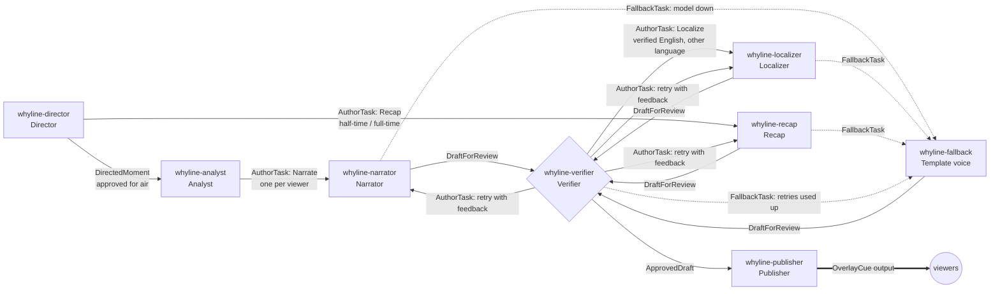
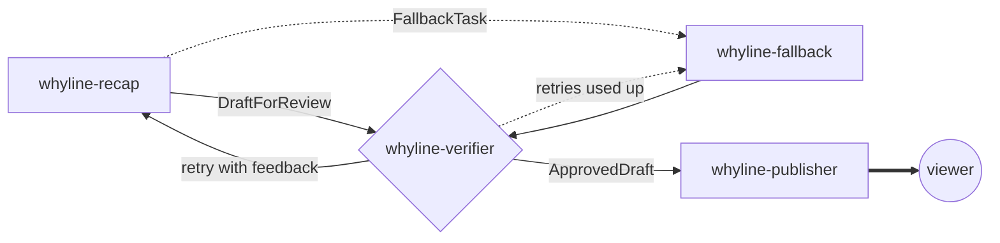

# Newsroom workflow (Microsoft Agent Framework)

The newsroom runs as a **Microsoft Agent Framework workflow graph** (`Microsoft.Agents.AI.Workflows`), following
Microsoft's guidance to orchestrate multi-agent systems with workflows rather than manual chaining. Workflows give
coordination (parallel and conditional execution), state carried across agent boundaries in typed messages, branching
(retries, localisation, fallback) and transparency through workflow events.

Code: `src/WhyLine.Agents.Workflows` (`NewsroomWorkflow`, `NewsroomExecutors`). Each executor's id matches its agent's
name in `AgentCatalog` (see [agents.md](agents.md)). The logic of each step lives in `NewsroomSteps`, which the
in-process runner (`NewsroomPipeline`, used offline and in tests) shares, so both orchestrators walk the same graph.

## Moment workflow

Started once per detected moment with a `MomentWork` message. The Director runs first: it is deterministic and takes
microseconds, so moments that will never air (stale, below every viewer's threshold, over the screen-time budget,
already told) are dropped before any model call. Up to `Agents:MaxConcurrentMoments` moments run at once, so a slow
model call on one moment does not hold up the next.

| Edge | Message | Condition |
|---|---|---|
| Director → Analyst | `DirectedMoment` | the moment is approved for at least one viewer |
| Director → Recap | `AuthorTask` | stage is Recap (half-time and full-time) |
| Analyst → Narrator | `AuthorTask` | stage is Narrate (one message per approved viewer: fan-out) |
| Narrator, Localizer, Recap → Verifier | `DraftForReview` | the model returned a draft |
| Narrator, Localizer, Recap → Fallback | `FallbackTask` | the model was unavailable or timed out |
| Fallback → Verifier | `DraftForReview` | always (fallbacks are verified too) |
| Verifier → Narrator / Recap / Localizer | `AuthorTask` | rejected with feedback and retries remain (back to the same author) |
| Verifier → Localizer | `AuthorTask` | English draft verified and the viewer wants another language |
| Verifier → Fallback | `FallbackTask` | rejected and retries used up |
| Verifier → Publisher | `ApprovedDraft` | passed every check |
| Publisher ⇒ output | `OverlayCue` | yielded as the workflow output, then broadcast |

A fallback that still fails verification is dropped: nothing unverified is ever published.

## Catch-me-up workflow

Started on demand with an `AuthorTask` (stage Recap). It reuses the Recap, Verifier, Fallback and Publisher
executors, skips the Analyst and Director, and returns the cue to the viewer instead of broadcasting it.

## Configuration

`Agents:Orchestration` is `Workflow` (default) or `InProcess`. Builds made with `-p:WhyLineFoundry=false` (no NuGet
access) always use the in-process runner.
